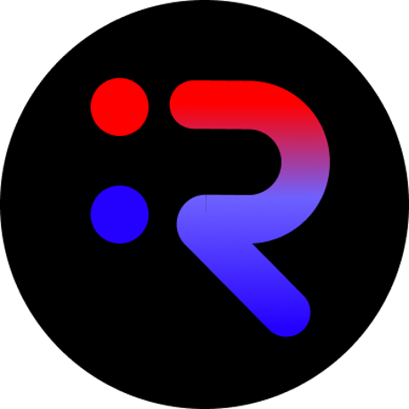
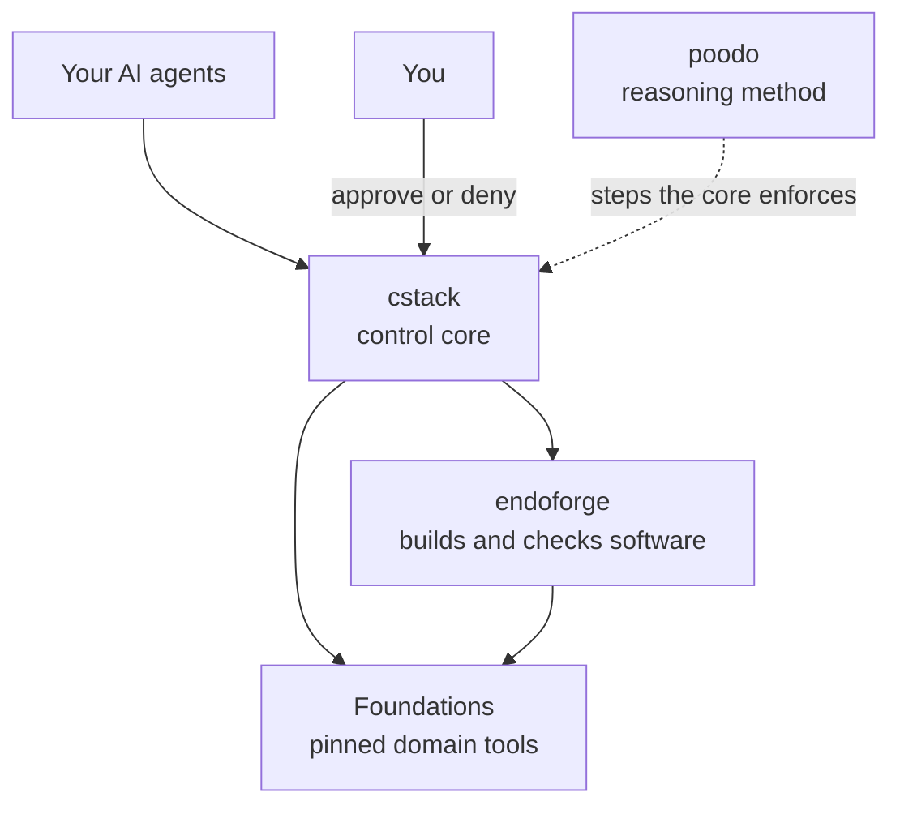

  

# Akilleez

Open-source engineering work from Refrigeration.AI. Most of it is one family of projects, the Cstack family, named after its central repository, [cstack](https://github.com/Akilleez-QA/cstack). Its tools are for building and running software with AI agents on your own machine, where risky actions wait for a human, domain calculations come from pinned and tested packages, and every result is recorded with its evidence.

## How the family fits together

**cstack** is the host: a local-first system you fork and run on your own machine, and your agents connect to it. It makes them state a goal and their reasoning in the order **poodo** defines (poodo is also usable on its own, as an agent skill), holds risky calls for your approval, and runs domain tools only from **Foundations** whose files match their recorded hashes. When agents build software, cstack hands the job to **endoforge**, the runtime where coding agents build real software: it finds, reuses or generates code, checks it inside fast V8-isolate workcells against an independent evaluator the code never saw, and records the result in a tamper-evident ledger so trusted code gets reused.

## The projects

A *Foundation* is a package of domain tools that cstack runs only while its files match their recorded hashes. The ones below are working examples from different fields; a new domain starts from foundation-template.

| Project | What it is | Role |
|---|---|---|
| [cstack](https://github.com/Akilleez-QA/cstack) | A local-first system for building and running software with AI agents under your control: one control core owns goals, decisions, permissions and evidence, Foundations supply domain knowledge and checks, and anything risky waits for a human | Host |
| [endoforge](https://github.com/Akilleez-QA/endoforge) | The runtime where coding agents build real software. It finds, reuses or generates code, checks it inside fast V8-isolate workcells against an independent evaluator the code never saw, and records the result in a tamper-evident ledger so trusted code gets reused | Runtime for building software |
| [poodo](https://github.com/Akilleez-QA/poodo) | A skill (instructions an agent loads) that makes it show its evidence before it acts, for Codex and Agent Skills clients | Reasoning method |
| [foundation-math](https://github.com/Akilleez-QA/foundation-math) | Exact mathematical kernels, certificate verifiers and evidence reports in standard-library Python | Foundation |
| [foundation-refrigeration](https://github.com/Akilleez-QA/foundation-refrigeration) | Read-only refrigeration reference data: saturation tables generated with CoolProp, unit conversion, cited ammonia exposure limits. Not for safety decisions | Foundation |
| [foundation-film](https://github.com/Akilleez-QA/foundation-film) | Read-only film acceptance checks (cinematic bands, audio mix, control drift, cue vocabulary, look). Observations, not acceptance decisions | Foundation |
| [foundation-robotics](https://github.com/Akilleez-QA/foundation-robotics) | Read-only physics checks for motion (timing, gait, balance, kinematics, mechanisms). Observations, not engineering approvals | Foundation |
| [foundation-engine](https://github.com/Akilleez-QA/foundation-engine) | Genre-neutral TypeScript and three.js engine for browser games, with performance budgets as contracts and requirements traced to tests | Foundation (cstack uses only two of its read-only validators) |
| [foundation-template](https://github.com/Akilleez-QA/foundation-template) | A minimal working Foundation to copy for a new domain | Foundation starter |

New here? Start with the [cstack README](https://github.com/Akilleez-QA/cstack#readme): it runs an approval example in a few minutes, with no API key.

The family's code name, Mjölnir, appears in these repositories' descriptions.

## License

Every repository listed above is available under GPL-3.0-only. If you want to use them to create a product or service under different terms, commercial licenses are available from Refrigeration.AI. Contact craig@nh3.biz.
